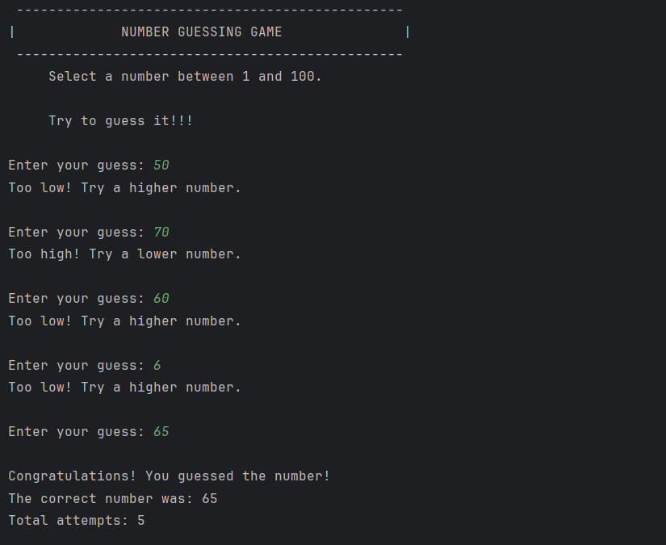
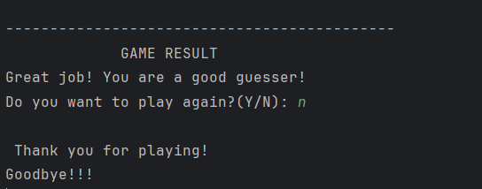

# Number Guessing Game

## About
This is a simple Java console-based game where the computer generates a random number between 1 and 100. The player tries to guess the correct number using the hints provided by the program.

## Features
- Generate a random number.
- Allow users to enter guesses.
- Display higher or lower hints.
- Count the number of attempts.
- Validate user input.
- Allow users to play again.

## Technologies Used
- Java
- IntelliJ IDEA

## How to Run
1. Open the project in IntelliJ IDEA.
2. Open `NumberGuessingGame.java`.
3. Run the `main()` method.
4. Follow the instructions in the console.

## Project Structure

```text
NumberGuessingGame/
├── src/
│   └── NumberGuessingGame.java
├── screenshots/
│   ├── GameHomePage.png
│   └── GameResult.png
└── README.md
```
## Game Screenshots

### Game Home Menu


### Game Result


## Internship Details
- **Organization:** Auspify Technologies
- **Internship:** Java Development Internship
- **Task:** Task 02 – Number Guessing Game